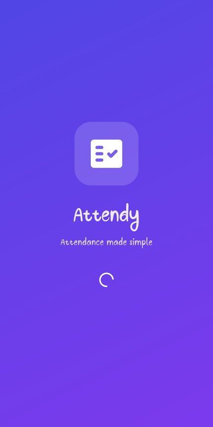
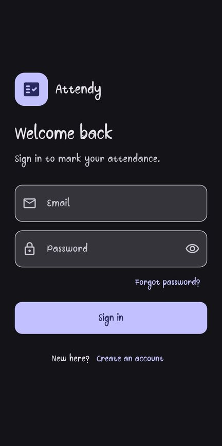
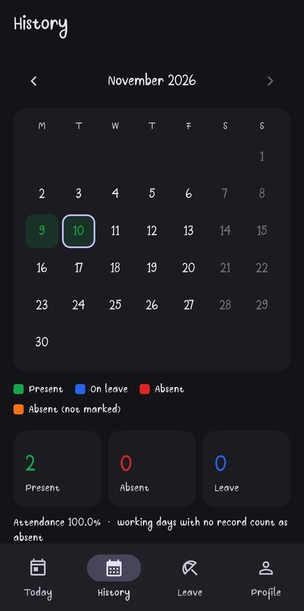
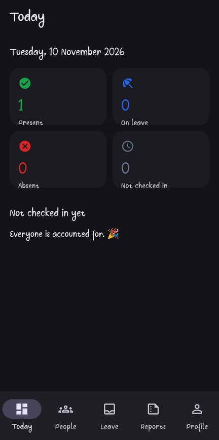
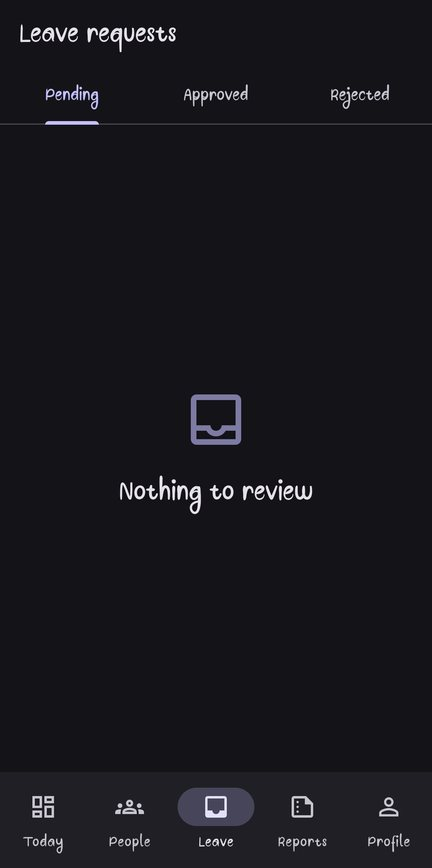
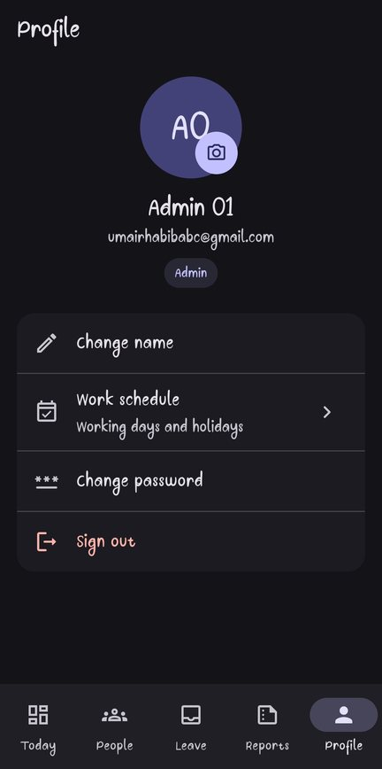

# Attendy

**A team attendance app for Android, built with Flutter and Firebase: members check in with one tap and request leave; admins see who's in today, approve leave, correct records and export CSV or PDF reports.**

[](https://github.com/Umair-Habibx123/attendy/actions/workflows/ci.yml)
[](https://github.com/Umair-Habibx123/attendy/releases/latest)
[](https://flutter.dev)
[](https://firebase.google.com)
[](LICENSE)

**[⬇️ Download the latest APK](https://github.com/Umair-Habibx123/attendy/releases/latest)** · Android 7.0+

> This is the rebuilt version of my first attendance app, **[Attendy (SQLite)](https://github.com/Umair-Habibx123/attendy-sqlite)**, which kept everything on one phone. Attendy moves it to Firebase with real accounts and server-side security, and runs on Firebase's free Spark plan.

| Splash | Sign in | Member history |
| :---: | :---: | :---: |
|  |  |  |
| **Admin: today** | **Admin: leave inbox** | **Admin: profile** |
|  |  |  |

## Features

**Members**
- **Accounts:** sign up with email and password, verify your email, and reset a forgotten password
- **One-tap check-in** for today, recorded with the **server's time**, so changing the phone's date doesn't work
- **History:** a colour-coded month calendar with present, absent and leave totals and an attendance rate
- **Leave:** request it for a date range with a reason, follow its status (pending, approved or rejected), and withdraw it while pending
- **Profile:** name, photo and password

**Everyone**
- **Real internet check:** a "No internet" screen with Retry, using the same reachability probe Android uses (`gstatic.com/generate_204`), not just "Wi-Fi is on"

**Admins**
- **Today:** who's present, on leave or absent, and who hasn't checked in yet
- **Leave inbox:** approve or reject with a note. Approving marks every working day in the range as leave automatically
- **People:** search everyone, open anyone's calendar, and **correct any day**; promote members to admin or deactivate accounts
- **Reports:** pick a period (this month, last month, this year or custom) and export **CSV** for spreadsheets or **PDF** to share or print
- **Work schedule:** choose which weekdays are working days (for example, add Saturday) and add holidays. It applies to everyone instantly, so days off never count as absent and leave skips them

## How security works

The rules in [`firestore.rules`](firestore.rules) enforce all of this on Firebase's servers, so a modified app can't get around them:

| Rule | Why |
|---|---|
| Everyone signs up as a regular member | Only an existing admin can make someone an admin |
| A member can mark only **themselves**, only **present**, and only **today** | "Today" comes from the server clock in the organisation's time zone (UTC+5) |
| Marked days can't be edited or deleted by members | Only admins correct records |
| Leave can't be backdated or self-approved | Admins decide pending requests, and a decision is final |
| Admins can't demote or deactivate themselves | There's always at least one admin |
| Only admins change the work schedule | Members can read it but not edit their own days off |
| Passwords live only in Firebase Authentication | No password or hash is ever stored in the database |

These rules have **23 automated tests** that run in the Firestore emulator on every push, including the attacks: faking the date, self-promotion, editing a marked day and approving your own leave.

## Install

1. Open the **[latest release](https://github.com/Umair-Habibx123/attendy/releases/latest)** and download `Attendy-vX.Y.Z.apk`.
2. Optionally check it against the `.sha256` file next to it.
3. Open the APK on your phone and allow installing from that app if Android asks.

## Run your own copy

You need **Flutter 3.47+**, the Android SDK, Node.js 20+ and a Firebase project (the free Spark plan is enough).

1. **Firebase project:**
   - Enable **Authentication → Email/Password** and **Cloud Firestore**.
   - Add an Android app with your package name, and put `google-services.json` in `android/app/`.
2. **`.env`:** create it in the project root with your Firebase app values. The `FIREBASE_*` names are listed in `lib/firebase_options.dart`.
3. **Deploy the security rules and indexes:**
   ```bash
   cd firestore-tests && npm ci
   npx firebase login
   npx firebase deploy --only firestore --project <your-project-id> --config ../firebase.json
   ```
4. **Run the app:** `flutter pub get`, then `flutter run`.
5. **Create the first admin:** sign up in the app, then in the Firebase console open `users/<your uid>` and set `role` to `admin`. After that, promote people from the app's **People** screen.

Admins set working days and holidays in the app (**Profile → Work schedule**); until then it's Monday to Friday. The time zone is set in [`lib/core/config.dart`](lib/core/config.dart). If you change it, update `orgToday()` in `firestore.rules` to match.

| Command | What it does |
|---|---|
| `flutter test` | Unit tests: organisation time, day keys, work schedule, absence counting and CSV export |
| `cd firestore-tests && npm test` | Security-rule tests in the Firestore emulator (needs Java 11+) |
| `flutter analyze` | Static analysis |

## How it's built

| Part | What it uses |
|---|---|
| Accounts | Firebase Authentication (email and password, email verification) |
| Data | Cloud Firestore, protected by security rules |
| Reports | `pdf` for PDF files and `share_plus` to share them |
| UI | Material 3 |

```
lib/
├── core/        config, organisation time and dates, attendance totals, validators
├── models/      user, attendance status, leave request
├── data/        auth service and Firestore repositories (users, attendance, leave)
├── reports/     report building, CSV and PDF export
└── ui/          sign-in, member screens, admin screens, shared widgets
firestore.rules            who can read and write what
firestore.indexes.json     indexes the app's queries need
firestore-tests/           rule tests for the emulator
```

**Data model:**
- `users/{uid}`: name, email, role, active and photo
- `attendance/{uid}/days/{yyyy-MM-dd}`: one document per day
- `leaveRequests/{id}`: dates, reason and status
- `settings/organization`: working weekdays and holidays

A working day with no record counts as absent once it has passed. Profile photos are small compressed thumbnails, because Cloud Storage isn't part of the free plan.

## License

[MIT](LICENSE) © 2025 [Umair Habib](https://github.com/Umair-Habibx123)
